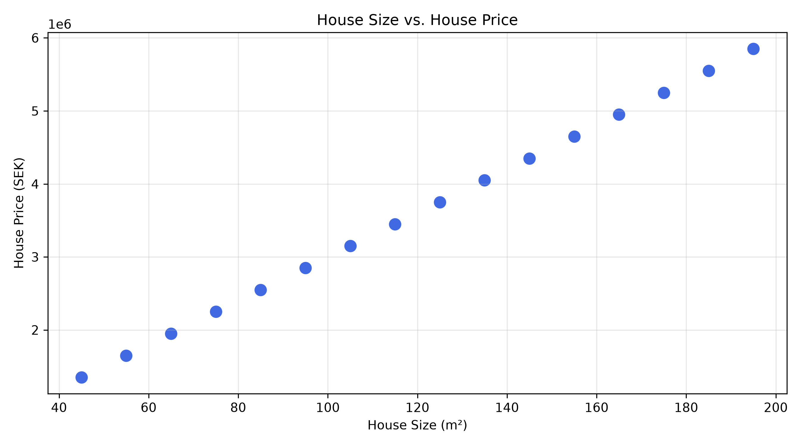
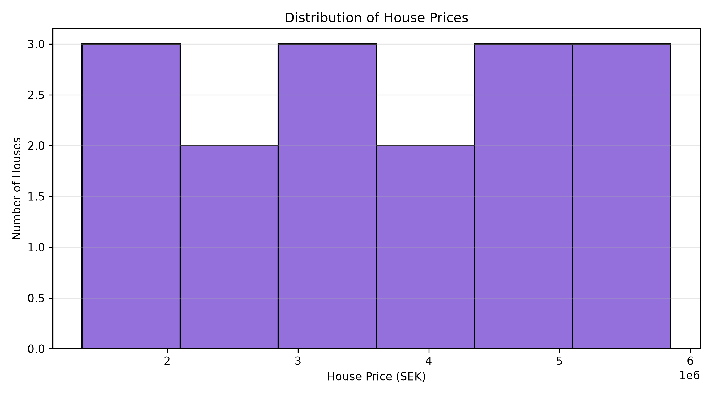
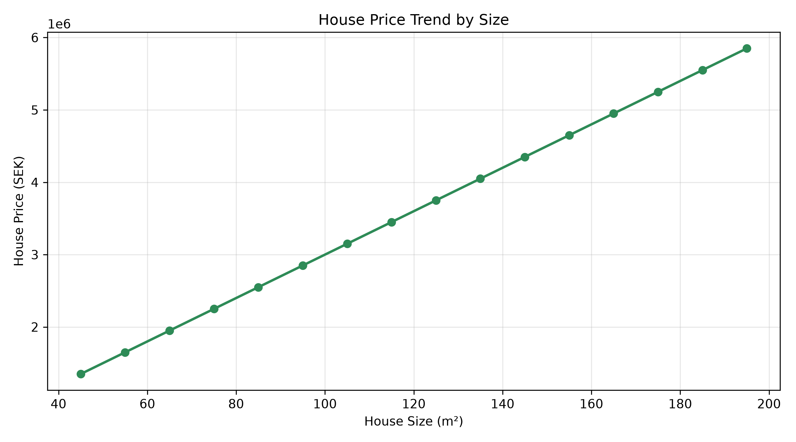
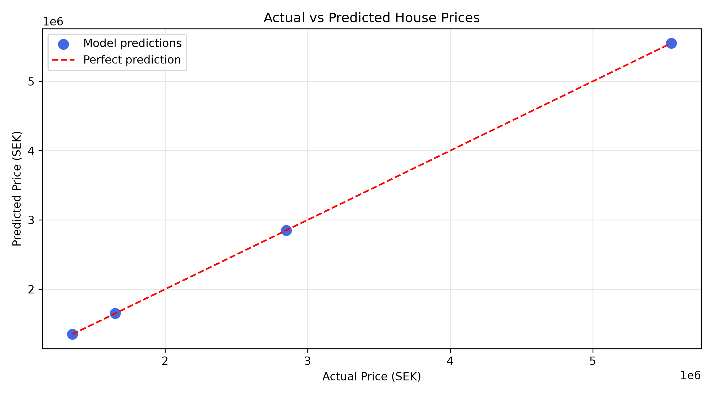
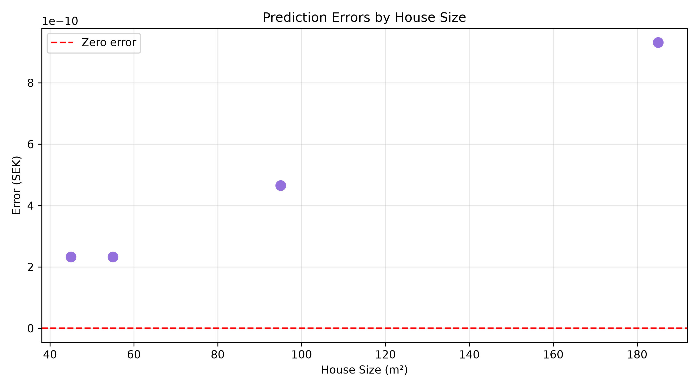

# House Price Prediction Using Python and Machine Learning

A beginner-friendly Data Science portfolio project demonstrating data analysis, visualisation, machine learning and model evaluation using Python.

## Project Overview

This project explores a fictional dataset of 16 houses and uses Linear Regression to predict house prices based on property size.

The goal was to learn the fundamental steps of a supervised machine learning workflow, from exploring the data to evaluating model predictions.

## Technologies Used

- Python
- Pandas
- Matplotlib
- scikit-learn
- Visual Studio Code
- Git and GitHub

## Dataset

The dataset contains 16 fictional houses with two main features:

- `Size_m2` — house size in square metres
- `Price_SEK` — house price in Swedish kronor

All house prices follow a deliberately simple linear relationship. The dataset is intended for educational purposes and does not represent real Swedish property prices.

## Project Workflow

1. Loaded and explored the dataset using Pandas.
2. Checked for missing values and duplicates.
3. Calculated descriptive statistics and price per square metre.
4. Created data visualisations using Matplotlib.
5. Split the data into training (75%) and testing (25%) sets.
6. Trained a Linear Regression model using scikit-learn.
7. Evaluated predictions using MAE, RMSE and R².
8. Saved predictions and evaluation charts.

## Results

The model learned an increase of approximately 30,000 SEK per additional square metre.

For a house measuring 120 m², the model predicts approximately 3,600,000 SEK.

The model achieved:

- Mean Absolute Error: approximately 0 SEK
- Root Mean Squared Error: approximately 0 SEK
- R² Score: 1.00

These near-perfect results are expected because the fictional dataset was generated using an exact linear relationship. They should not be interpreted as evidence of real-world prediction accuracy.

## Visualisations

### House Size vs. Price

### House Price Distribution

### House Price Trend

### Actual vs. Predicted Prices

### Prediction Errors

## How to Run

Clone or download this repository, open a terminal in the project folder, and install the required libraries:

`python -m pip install -r requirements.txt`

Run the scripts:

- `python src/main.py` — basic dataset summary
- `python src/analysis.py` — exploratory data analysis
- `python src/charts.py` — create data visualisations
- `python src/model.py` — train the Linear Regression model
- `python src/evaluation.py` — evaluate the model and save predictions

## What I Learned

Through this project, I practised:

- Working with CSV datasets using Pandas
- Exploratory data analysis
- Descriptive statistics and correlation
- Creating and saving visualisations
- Splitting data into training and testing sets
- Training a Linear Regression model
- Evaluating predictions using regression metrics
- Organising and documenting a Python project

## Limitations and Future Improvements

The current dataset is small and artificially generated. House prices depend on many factors beyond property size.

Future improvements could include using a real housing dataset, adding more features such as location and number of rooms, and comparing multiple regression models.

## Author

Claudia Ramos

Data Scientist student at EC Utbildning, Sweden.

Created as part of my Data Science portfolio.